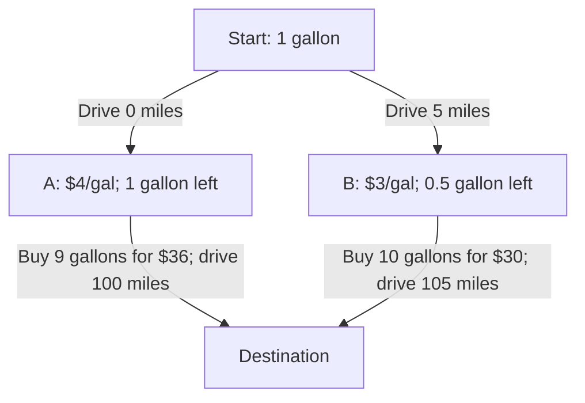

# Track Route

## Problem

Given a start and destination in the USA and a fuel-price CSV, choose where to refuel and how much to buy to minimize fuel purchase cost. Return the route, stops, total cost, and a map for a vehicle that gets **10 mpg**, holds **50 gallons**, and has a **500-mile range**.

## Solution and algorithm

The Django API uses ORS for the driving route, computes fuel purchases locally, and returns JSON with an interactive Leaflet map.

The planner uses **Dijkstra over `(station, route context, remaining fuel)` states** to minimize fuel purchase cost. Each transition buys fuel and travels to another station. Fuel belongs in the state because reaching the same station with different amounts remaining changes the cheapest continuation.

For each possible next refill stop, the planner applies the [Gas Station Problem](https://www.cs.umd.edu/projects/gas/) purchase rule:

| Next refill stop | Purchase at the current station |
| --- | --- |
| More expensive | Fill the tank. |
| Cheaper or equally priced | Buy only the missing fuel needed to reach it. |
| Destination | Buy only the missing fuel needed to finish. |

The search compares complete stop sequences, including detour consumption:

```text
leg miles = return to route + forward route miles + access to next station
fuel consumed = leg miles / 10
purchase cost = gallons bought × station price
```

| Concern | How the planner handles it |
| --- | --- |
| Tank capacity | Departure fuel cannot exceed 50 gallons. |
| Reachability | Each leg must fit the departure fuel. No fixed corridor is used. |
| Detours | Follow the ORS route forward; count station access before purchasing and the return afterward. |
| Future stations | Stations outside the current range remain available after refueling. |
| Pruning | At the same station and route context, discard a state if another has at least as much fuel at no greater cost. |
| Precision | Use exact rational fuel and cost calculations; round only for display. |

### Example

The truck has **1 gallon**, and the destination is **100 route miles ahead**:



B's outgoing leg includes the 5-mile return to the route. The detour consumes one extra gallon, but the complete plan costs **$6 less**.

## Verification

```sh
uv run python manage.py test
uv run python manage.py check
```

Small cases are checked against an independent solver with dominance enabled and disabled. Provider HTTP calls are mocked.

In the [1,200-mile fixture](apps/fuel_planning/tests/test_optimizer.py), a full starting tank leads to purchases of **45 gallons at $3.00** and **25 at $3.50**, totaling **$222.50**. The truck consumes 120 gallons, of which 70 are purchased.

## Run locally

Requires **Python 3.14+**, **uv**, and an **ORS API key**. Copy [.env.example](.env.example) to `.env` and set `ORS_API_KEY` and `NOMINATIM_USER_AGENT`.

```sh
uv sync
uv run --env-file .env python manage.py runserver --noreload
```

The prepared CSV is included; no database setup or migrations are required. Use one application process with public Nominatim. Requests are serialized and rate-limited to respect its [one-request-per-second application limit](https://operations.osmfoundation.org/policies/nominatim/).

## API

```sh
curl -i http://127.0.0.1:8000/api/trips/plan/ \
  -H 'Content-Type: application/json' \
  -d '{"start":"Los Angeles, CA","destination":"Austin, TX"}'
```

Optional `initial_fuel_gallons` accepts **0–50**, defaulting to **50**. Initial fuel is treated as already paid for.

The response includes `path`, `stops`, `totals`, `search_complete`, and `map_url`. Amounts are decimal strings. Import the [Postman collection](docs/track-route.postman_collection.json) to try this request.

**Provider usage:** one ORS request per route-cache miss, zero on a hit. Fuel planning runs locally. Process-local caches reuse locations, routes, and completed plans; caches and map URLs are temporary. `X-ORS-Requests`, `X-Geocoding-Requests`, and `X-Plan-Cache` expose request usage and reuse.

## Accuracy and scope

Station coordinates are prepared with Census geocoding and a city/state fallback. Access and return distances are geodesic estimates, not verified road connections; the map distinguishes them from the ORS path.

A completed search is optimal **within this route and distance model**. 

[Architecture and limits](docs/architecture.md) · [Assessment requirements](docs/assignment.md)
